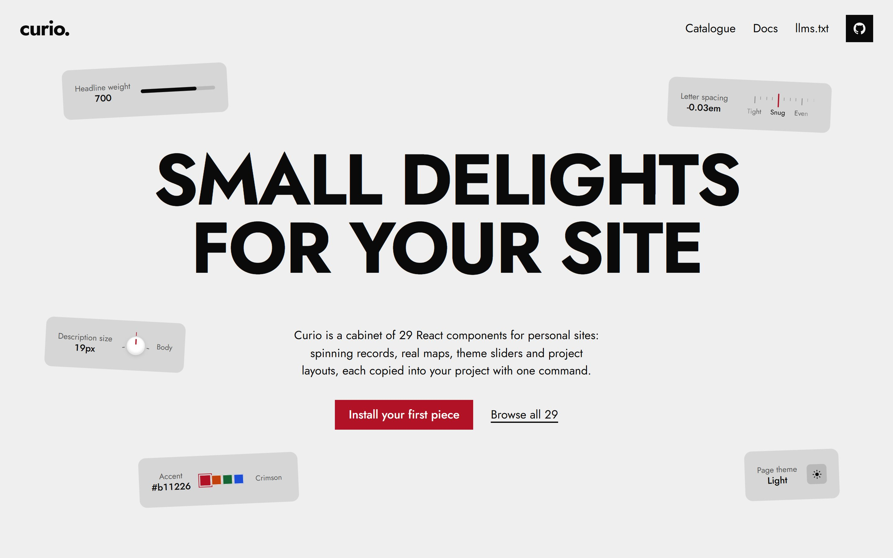
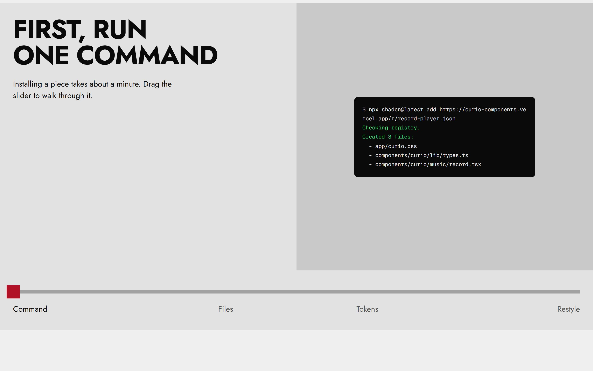
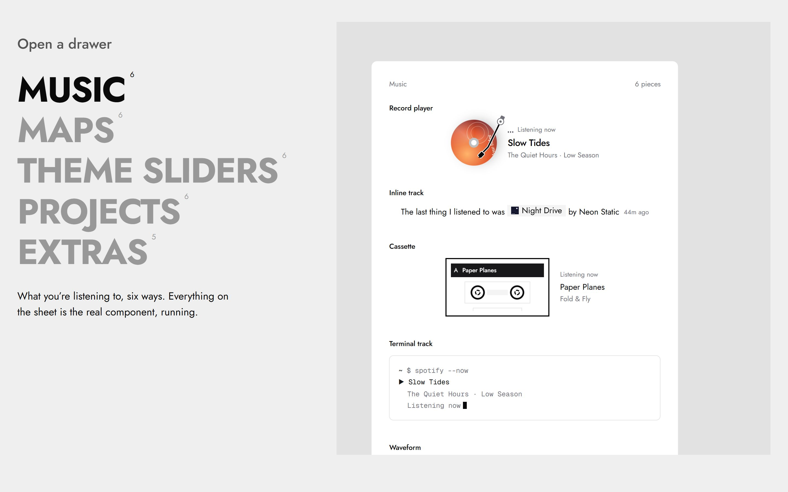
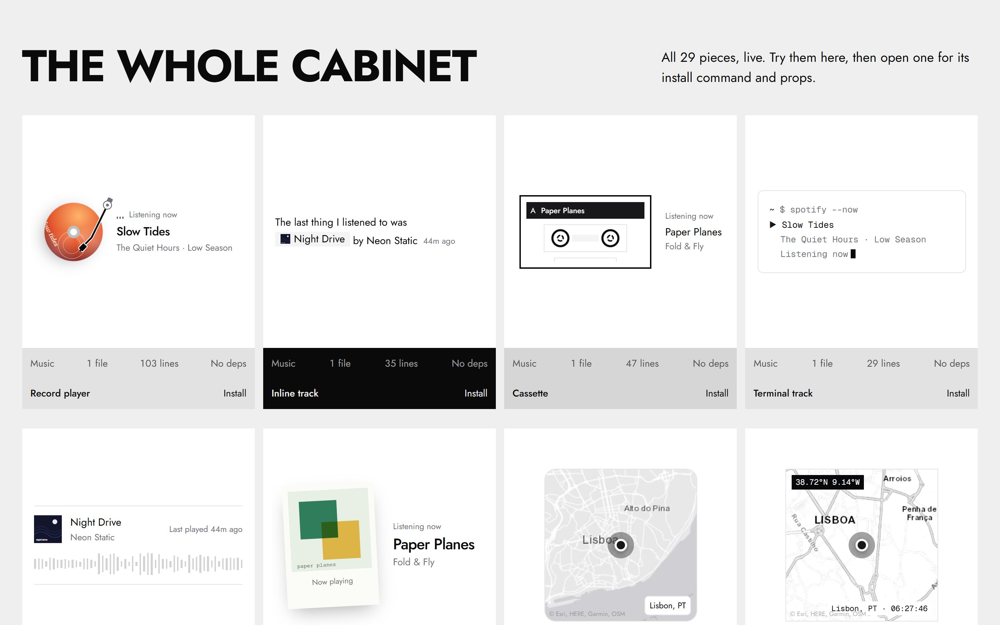
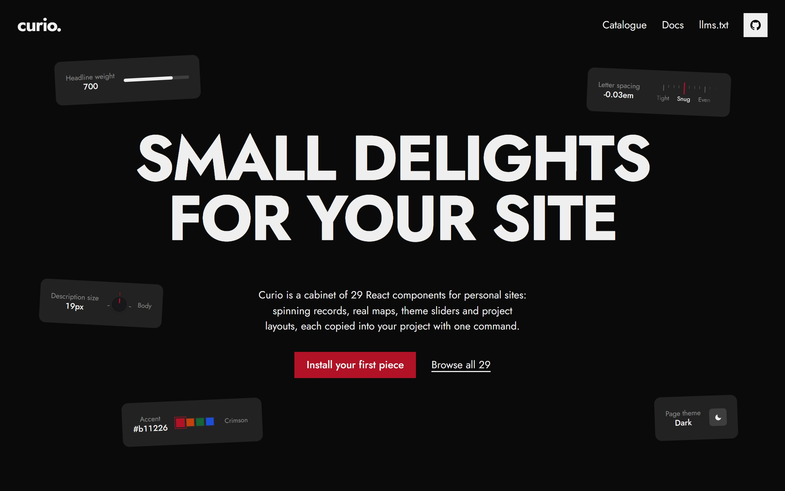
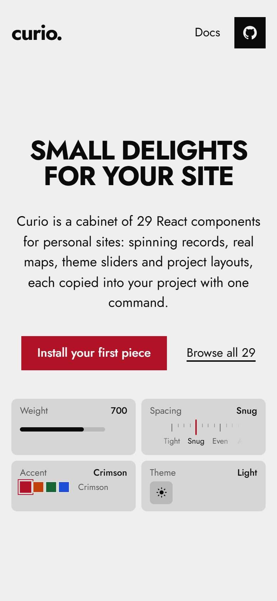
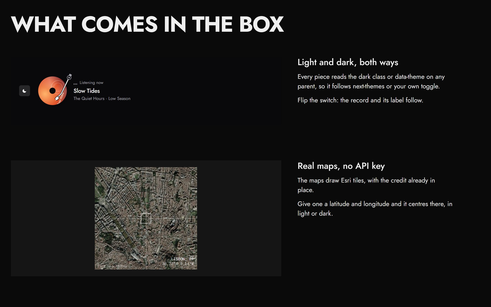

<div align="center">


# curio.

**Small, delightful React components for personal sites.**

Spinning records, real maps, theme sliders and project layouts. 29 pieces, each one copied into your project with a single command.

[Live site](https://curio-components.vercel.app) · [Docs](https://curio-components.vercel.app/docs) · [llms.txt](https://curio-components.vercel.app/llms.txt)

</div>



## Why curio

Most component libraries give you buttons, inputs and dialogs. Curio gives you the other things: the details that make a page feel like it belongs to someone. A record that spins while you're listening. A map of your city. A slider that moves the sun across the sky. A timeline of what you've built.

Every piece is built to the standard you'd expect from a design-led product, not a weekend template:

- **Crafted motion.** Records spin and their tonearm swings in when music plays. Sliders stretch past their ends and settle back with a spring. The theme toggle morphs a sun into a moon and reveals the new theme in a growing circle. Every animation switches off for visitors who ask for reduced motion.
- **Real data, real tiles.** Music pieces take a live track (Spotify, Last.fm or your own API). Maps draw real Esri tiles, light and dark, with no API key and the credit already in place.
- **Accessible by default.** Sliders are real sliders: arrow keys, Home and End, proper ARIA roles and readable values. Every control has a focus state and a label.
- **Light and dark, both ways.** Every piece follows a `.dark` class or `data-theme` on any parent, so it works with next-themes or your own toggle out of the box.
- **Eight tokens, one look.** A neutral default you restyle with eight `--curio-*` CSS variables. Change `--curio-accent` and all 29 pieces follow.
- **No runtime dependencies.** Just React and Tailwind CSS v4. Nothing extra lands in your bundle.
- **The code is yours.** Nothing is imported from a package. The files are copied into your project, ready to read and change.

## Install a piece

```bash
npx shadcn@latest add https://curio-components.vercel.app/r/record-player.json
```

Then import the tokens once in your global stylesheet:

```css
@import "tailwindcss";
@import "./curio.css";
```

That's it. The component lives in `components/curio/` and is yours to edit.



## The cabinet

Five drawers, 29 pieces. Try every one live on the [site](https://curio-components.vercel.app/#catalogue).

| Drawer | Pieces |
| --- | --- |
| **Music** | Record player, Inline track, Cassette, Terminal track, Waveform, Polaroid |
| **Maps** | Classic, Mono, Satellite, Blueprint, Zoom, Radar |
| **Theme sliders** | Pill, Sun arc, Knob, Swatch, Ruler, Gradient |
| **Projects** | Timeline, Sentence, Hover preview, Accordion, Tiles, Status rows |
| **Extras** | Hover cards, Contribution grid, Pronounce button, Theme toggle, Live clock |





## Made to be restyled

Curio ships with a quiet, neutral look so it fits any site. Make it yours in a few lines:

```css
:root {
  --curio-bg: #fff7ed;
  --curio-accent: #c2410c;
}
.dark {
  --curio-bg: #0b0b0f;
  --curio-accent: #fb923c;
}
```

<table>
  <tr>
    <td></td>
    <td width="28%"></td>
  </tr>
</table>



## Use it with AI

Curio publishes [`llms.txt`](https://curio-components.vercel.app/llms.txt): every piece, what it does and its install URL. Point Claude, Cursor or any coding agent at it and ask for what you want:

```text
Read https://curio-components.vercel.app/llms.txt, then add a music player
and a map of my city to the homepage.
```

Using the shadcn MCP server? Add curio as a registry in `components.json` and install by name:

```json
{
  "registries": {
    "@curio": "https://curio-components.vercel.app/r/{name}.json"
  }
}
```

```bash
npx shadcn@latest add @curio/record-player
```

## Working on curio

```
registry/curio/          the components (what gets copied into people's projects)
registry.json            the catalogue: names, descriptions, files
scripts/                 builds public/r/*.json and public/llms.txt from the catalogue
app/                     the showcase and docs site
components/landing/      the landing page sections
components/previews.tsx  live demos used across the site
lib/docs-meta.ts         usage snippets and props for each docs page
```

```bash
npm install
npm run dev      # site on localhost:3200
npm run build    # builds the registry, then the site
```

On Vercel, install URLs follow the project's production domain automatically. Anywhere else, set `CURIO_URL` and `NEXT_PUBLIC_CURIO_URL` to your domain.

### Adding a piece

1. Write it in `registry/curio/<drawer>/`, using the `--curio-*` tokens for colour.
2. Add an entry to `registry.json`.
3. Add a demo in `components/previews.tsx` and usage and props in `lib/docs-meta.ts`.
4. Run `npm run registry`.

## Credits

Built with Next.js, React and Tailwind CSS. Map tiles © Esri. Engravings on the site via Wikimedia Commons: *Musei Wormiani Historia* (1655) and *Ritratto del Museo di Ferrante Imperato* (1599), both public domain, and a specimen drawer from the Carnegie Museum of Natural History (CC0).

Made by [Kushagra](https://github.com/kushagraaj).
